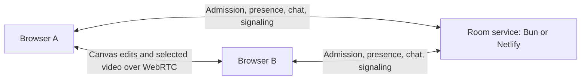

# How Common fits together

Common puts the shared workspace in people's browsers. A small room service
helps them join, find each other, and exchange connection information. The same
frontend runs with a standalone Bun server, inside another Bun app, or on Netlify.

## Follow a room from the browser

This shows the default peer rooms created by the browser app. Canvas connections
form a sparse network; video subscriptions choose which windows each viewer
receives. A room service connection alone does not establish a working peer route.
The [room protocol](../API.md) also documents legacy server-canvas rooms.

## Keep three responsibilities distinct

| Part | Owns | Start in the code |
| --- | --- | --- |
| Workspace | Objects, tools, personal views, and presentation | [`src/main.js`](../src/main.js), [`src/spatial/main.js`](../src/spatial/main.js), [`src/board.js`](../src/board.js) |
| Shared documents | Canvas convergence and, for Space & Time, board history | [`src/shared-canvas.js`](../src/shared-canvas.js), [`src/peer-canvas.js`](../src/peer-canvas.js), [`src/spatial/store.js`](../src/spatial/store.js) |
| Room service | Password admission, participant presence, signaling, chat, and session metadata | [`lib/local-session.mjs`](../lib/local-session.mjs), [`netlify/lib/api.mjs`](../netlify/lib/api.mjs), [`lib/session-protocol.mjs`](../lib/session-protocol.mjs) |

Classic is the default and uses Yjs for shared canvas state. Space & Time uses
Loro's WebAssembly engine for boards and automatic history. Resolve a room's
experience before loading its document engine; its metadata takes precedence
over a personal entry preference. These document formats are separate.

The geometry kernel also runs in WebAssembly, with a JavaScript fallback.
The interface and browser lifecycle remain JavaScript.

## Know where the work lives

Peer rooms keep their canvas documents in participating browsers. The room
backend does not store or restore those canvas objects. A late joiner needs a
connected peer holding the document.

Space & Time also autosaves its structured edits and history to this browser's
IndexedDB. **Saved on this device** reports a successful local save. A `.common`
export carries the workspace and history to a file you can keep. Historical
screen objects retain placement and identity; screen pixels need a recording.

Screen streams and retained recordings are separate from document history.
Recordings are local browser blobs: download them before closing or reloading.
Room credentials, chat, and other metadata follow the hosting adapter's own
retention rules. See [hosting and data handling](hosting.md) for the details.

## Choose the hosting boundary

- **Standalone Bun:** one server serves the frontend and the room API, using
  WebSocket transport and a local room file.
- **Embedded Bun:** `createCommon` attaches to the host's existing fetch and
  WebSocket server; `mountCommon` loads the UI in a same-origin iframe. The
  adapter defaults to in-memory rooms and private networking.
- **Netlify:** static frontend assets use Functions and Postgres for room
  coordination through HTTP polling.

The frontend reads `/api/config` at startup to select the transport and network
profile. The [embedding guide](embedding.md) explains SDK ownership and cleanup;
the [hosting guide](hosting.md) covers standalone and Netlify setup.

## Add an agent at the canvas boundary

The browser API and experimental WebMCP adapter use the same command registry as
the visible Agent tools panel. A person grants timed access in that tab. Native
window capture uses the browser's separate picker approval.

Agents edit the shared document through the current workspace. They use their
own tools for model calls, image generation, and product navigation. An external
A2A coordinator can pass findings to a presenter using this boundary; Common
currently supplies no built-in A2A transport or remote MCP server.

Start with the [agent recipes](../public/agent-examples.md). For a code change,
follow the [maintainer map and invariants](maintaining.md).
